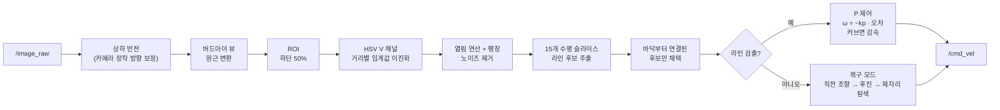

# 🛤️ TurtleBot3 + Jetson Nano 카메라 라인트레이싱 (실제 환경)


카메라 한 대만으로 바닥의 라인을 따라가는 ROS 2 노드입니다.
같은 알고리즘을 Gazebo 시뮬레이션에서 먼저 검증한 뒤, **TurtleBot3 Waffle에 카메라와 Jetson Nano를 올린 실물 로봇**으로 옮겨 트랙을 주행했습니다. 이 저장소는 그중 **실물 주행용 워크스페이스**입니다.

| 항목 | 내용 |
|---|---|
| 플랫폼 | ROS 2 Humble · Python · OpenCV · cv_bridge |
| 하드웨어 | TurtleBot3 Waffle (OpenCR + Dynamixel) · Jetson Nano · USB 카메라 |
| 입력 / 출력 | `/image_raw` (`sensor_msgs/Image`) → `/cmd_vel` (`geometry_msgs/TwistStamped`) |
| 제어 | 라인 중심 오차 기반 P 제어 + 커브 감속 + 라인 소실 시 3단계 복구 |

---

## 처리 흐름



### 1. 영상 전처리 ([`image_processing.py`](src/rover_line_follower/rover_line_follower/image_processing.py))
- **버드아이 뷰**: 화면 아래쪽 사다리꼴 영역을 직사각형으로 펴서 원근 때문에 휘어 보이는 라인을 바로잡습니다.
- **거리별 이진화**: HSV의 명도(V) 채널을 행마다 다른 범위로 이진화합니다. 가까운 행은 60~115, 먼 행은 60~135로 상한을 올려 조명 반사로 구간마다 밝기가 달라지는 문제에 대응합니다.
- **라인 후보 추출**: ROI를 15개 높이에서 가로로 잘라, 흰 픽셀이 10px 이내로 이어진 구간을 후보로 잡습니다. 폭 100px 초과이거나 픽셀이 70개를 넘는 구간은 바닥·배경으로 보고, 5픽셀 미만은 노이즈로 버립니다.
- **연결성 검증**: 가장 아래 슬라이스에서 화면 중앙에 가장 가까운 후보를 시작점으로, 위쪽 슬라이스로 올라가며 좌우 이동량과 폭 변화가 작은 후보만 이어 붙입니다. 바닥에서부터 이어지지 않는 반사광·잡음은 라인으로 인정하지 않습니다.

### 2. 제어 ([`line_follower.py`](src/rover_line_follower/rover_line_follower/line_follower.py))

| 상태 | 동작 |
|---|---|
| **TRACKING** | 최하단 라인 중심과 ROI 중심의 픽셀 오차로 `ω = −kp · error` (kp = 0.02). `|ω| < 0.3`이면 `linear_speed`, 크면 `curve_speed`로 감속하고 커브 방향을 기억 |
| **SEARCHING** | 라인을 놓친 뒤 10프레임까지: 직전 조향각을 유지한 채 `curve_speed`의 절반으로 전진 |
| **REVERSE** | 그 후 15프레임: 직진 후진 |
| **ROTATE** | 기억해 둔 커브 방향으로 제자리 회전(0.4 rad/s), 일정 각도마다 방향을 바꿔 좌우로 탐색 |

라인을 다시 찾으면 바로 TRACKING으로 돌아갑니다. 영상을 상하로만 뒤집어 처리하므로 좌우가 반대가 되어, 각속도는 발행할 때 부호를 한 번 더 바꿉니다.

### 파라미터

| 이름 | 기본값 | 설명 |
|---|---|---|
| `image_topic` | `/image_raw` | 카메라 토픽 |
| `cmd_vel_topic` | `/cmd_vel` | 속도 명령 토픽 (`TwistStamped`) |
| `linear_speed` | 1.2 | 직선 구간 선속도 (로봇 최대 속도에서 제한됨) |
| `curve_speed` | 0.4 | 커브 구간 선속도 |
| `kp` | 0.020 | 조향 P 게인 |
| `debug_view` | `true` | ROI / 이진화 / 버드아이 뷰 창 표시 (디스플레이 필요) |

## 저장소 구조

```
ros2_ws/
├── src/rover_line_follower/
│   ├── rover_line_follower/
│   │   ├── line_follower.py        # 메인 노드 (영상 구독 → 제어 → 속도 발행)
│   │   ├── image_processing.py     # 버드아이 뷰 · 이진화 · 슬라이스 · 연결성 검증
│   │   └── libs/utils.py           # 지도 기반 경로 추종 실험 코드 (현재 노드에서는 미사용)
│   ├── launch/line_follower.launch.py
│   ├── package.xml · setup.py
├── src/rover_line_follower.zip     # 위 패키지 백업 압축본
├── 99-turtlebot3-cdc.rules         # TurtleBot3 udev 규칙 (OpenCR, 라이다 장치 권한)
├── scan_motor.py                   # OpenCR에 연결된 Dynamixel 모터 ID 스캔 (1~10번 ping)
└── go.sh                           # ROS 2 Humble + 워크스페이스 환경 source
```

## 실행 방법

```bash
# 1. (최초 1회) TurtleBot3 udev 규칙 등록
sudo cp 99-turtlebot3-cdc.rules /etc/udev/rules.d/
sudo udevadm control --reload-rules && sudo udevadm trigger

# 2. 빌드
cd ~/ros2_ws
colcon build --symlink-install
source go.sh            # = source /opt/ros/humble/setup.sh && source install/setup.sh

# 3. 로봇 구동부와 카메라 실행 (각각 다른 터미널)
ros2 launch turtlebot3_bringup robot.launch.py
ros2 run v4l2_camera v4l2_camera_node      # /image_raw 발행

# 4. 라인트레이서 실행
ros2 launch rover_line_follower line_follower.launch.py
```

- 모터가 반응하지 않으면 런치 파일을 끈 상태에서 `python3 scan_motor.py`로 Dynamixel ID가 잡히는지 먼저 확인합니다. (`/dev/ttyOpenCR` 별칭이 있어야 하며, 12V 전원과 케이블을 확인)
- 노드는 속도를 `geometry_msgs/TwistStamped`로 발행합니다. 구동 노드가 `Twist`를 구독하는 환경이라면 타입을 맞춰야 합니다.
- 실물에서는 비전 처리와 제어 노드를 Jetson Nano 안에서 돌려 제어 루프를 로봇 내부에서 닫고, PC는 원격 모니터링만 맡겼습니다.

## 시뮬레이션 → 실물로 옮기며 맞춘 것
- **조명**: 시뮬레이션과 달리 바닥 조명 반사로 같은 라인의 밝기가 구간마다 달라져, 실제 조명 아래에서 검출 결과를 보며 V 채널 임계값을 다시 맞췄습니다.
- **카메라 방향**: 실물 카메라 장착 방향에 맞춰 입력 영상을 상하 반전한 뒤 처리합니다.
- **라인 소실**: 급커브에서 라인이 화면 밖으로 나가는 경우를 상태(탐색 → 후진 → 회전)로 정의해 주행이 멈추지 않게 했습니다.

---

### 관련 저장소
- [ros2-rover-simulation](https://github.com/bananabus6907/ros2-rover-simulation) — URDF/Xacro 로버 모델과 Gazebo 시뮬레이션 (로봇프로그래밍 과제)
- [hospital_robot_ws](https://github.com/bananabus6907/hospital_robot_ws) — 같은 TurtleBot3 구동부(OpenCR · Dynamixel)를 활용한 졸업작품 자율주행 휠체어
